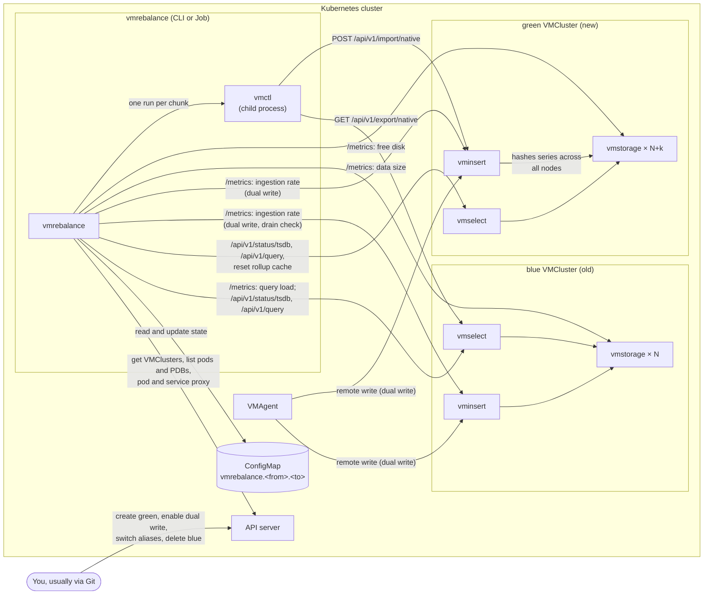
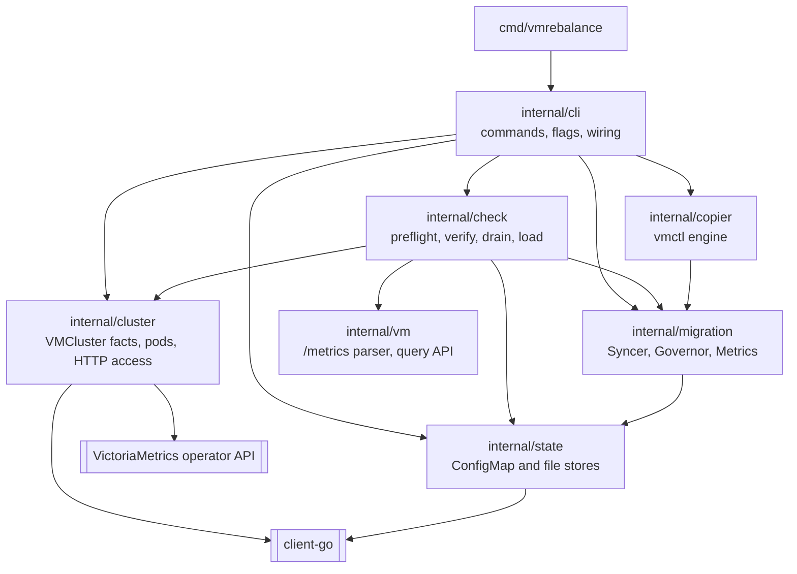
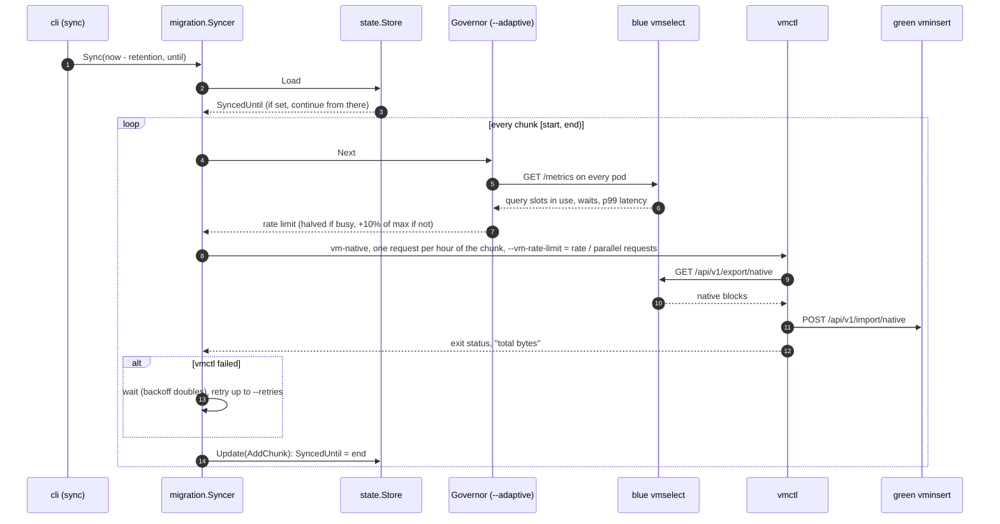
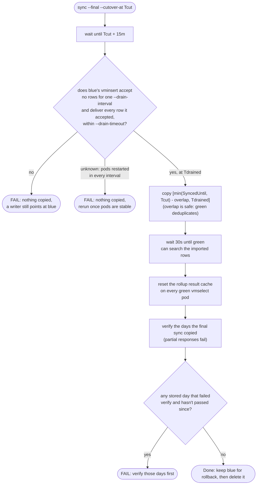
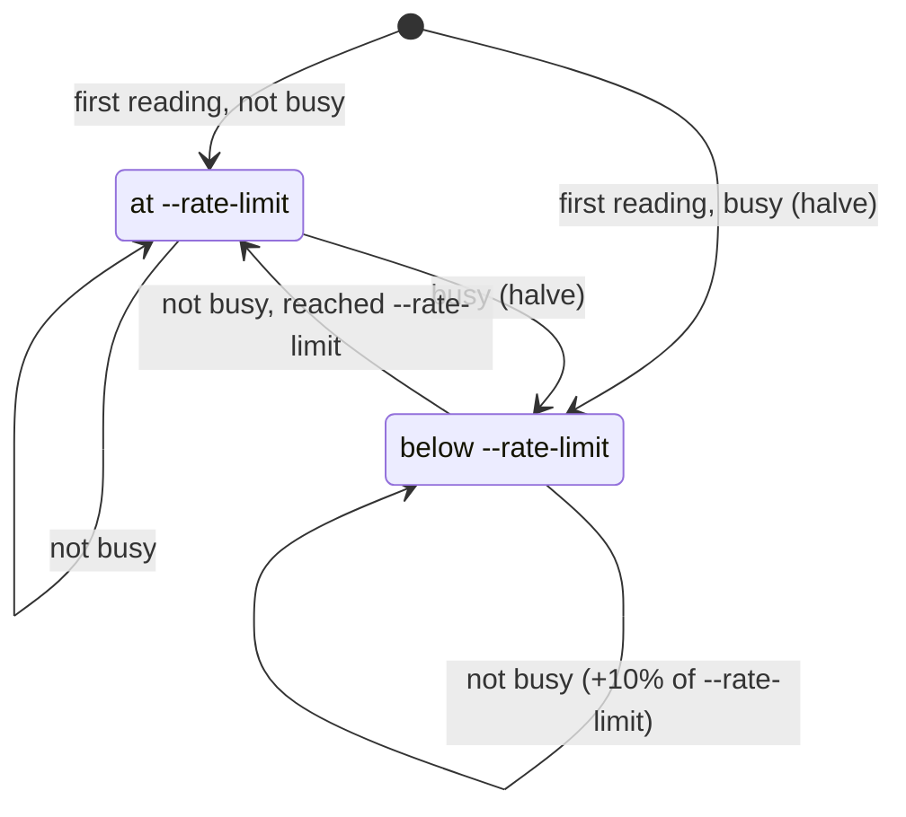

# Architecture

`vmrebalance` is one Go binary with four commands (`preflight`, `sync`, `verify`, `status`). It runs on a
workstation or as a Kubernetes Job. It reads the two VMCluster objects through the Kubernetes API, talks to
vmselect, vminsert and the pods over HTTP, and copies data by running
[vmctl](https://docs.victoriametrics.com/victoriametrics/vmctl/) once per chunk.

It never changes VMCluster, VMAgent or Service objects and never deletes data. The only object it writes is its
state ConfigMap. The [README](../README.md) describes a migration from the operator's side; this page describes how
the tool works and why it is built this way.

## Design decisions

- **Blue/green instead of rebalancing in place.** vmstorage can't safely take over another node's partitions,
  because metricIDs can collide across partitions
  ([#2324](https://github.com/VictoriaMetrics/VictoriaMetrics/issues/2324),
  [#10792](https://github.com/VictoriaMetrics/VictoriaMetrics/issues/10792)). Writing everything again through
  green's vminsert lets VictoriaMetrics itself spread the series across the new set of nodes.
- **The tool doesn't change Kubernetes objects.** In most setups a GitOps repository owns the VMCluster, VMAgent and
  Service objects. The tool says when each change is due and checks that it took effect. An `--apply` mode for
  setups without GitOps is on the [roadmap](roadmap.md).
- **vmctl as the copy engine.** Each chunk is one `vmctl vm-native` run: `GET /api/v1/export/native` on blue's
  vmselect, streamed into `POST /api/v1/import/native` on green's vminsert, one request per hour of the chunk,
  spread over `--concurrency` workers. The tool turns off vmctl's per-metric mode: that mode first lists metric names
  through `/api/v1/label/__name__/values`, which vmselect may answer partially when a vmstorage node is down, and
  vmctl would then skip the missing names and still succeed. A native export fails instead of returning partial
  data. vmctl doesn't retry requests in this mode, so the tool retries the whole chunk. vmctl applies its rate limit
  per request, so the tool divides `--rate-limit` by the number of requests that run at once. A copy engine written
  in Go would remove the vmctl binary and could change the rate within a chunk. It sits behind the same
  `migration.Copier` interface, so it can replace vmctl without other changes, if chunks turn out too coarse or too
  slow.
- **Same version on blue and green.** The native format is version-coupled, so `preflight` compares the image tags
  of all running components.
- **Dual write plus a final sync, with deduplication.** Dual write keeps green current without a gap, and the final
  sync covers writers that bypass VMAgent. The windows overlap on purpose (`[last sync - --final-overlap, blue
  drained]`, 1h by default). That is safe only because green runs with `-dedup.minScrapeInterval=1ms`, which
  `preflight` checks.
- **Time-ordered chunks with a high-water mark.** Chunks run oldest first and one at a time, so the state needs only
  the end of the last finished chunk to resume. Backfill and catch-up are the same operation: copy from the
  high-water mark to now.
- **State in a ConfigMap.** The tool needs Kubernetes API access anyway (to find pods and read the VMClusters), so
  a ConfigMap costs nothing extra and survives restarts of a Job's pod.
- **One tenant per run.** The tool copies the tenant in `--tenant` (default `0`), through
  `/select/<tenant>/prometheus` on blue and `/insert/<tenant>/prometheus` on green. Copying all tenants at once
  (vmctl's `--vm-intercluster`) is on the [roadmap](roadmap.md).

## System context

The data path is vmctl's: it streams blue's native export into green's vminsert, which spreads the series across
all green vmstorage nodes. Everything else the tool does is reading and checking.

## Packages

| Package | Responsibility |
|---|---|
| `internal/cli` | Cobra commands and flags. It connects to Kubernetes, opens both clusters and the state, wires the other packages together and prints the reports. It holds no migration logic. |
| `internal/migration` | `Syncer` splits a time range into step-aligned chunks, copies them in order with retries, and records each finished chunk. It also runs the final sync window. `Governor` picks each chunk's rate limit. `Metrics` holds the tool's own Prometheus metrics. |
| `internal/copier` | `VMCtl` implements `migration.Copier`. It builds the `vmctl vm-native` command line for a window and rate, and reads the transferred bytes from vmctl's output. |
| `internal/check` | Read-only checks over `cluster.Client`: `Preflight`, `VerifyDay`, `WaitDrained` (blue gets no more writes), and `SelectLoad` (blue's vmselect load, which the Governor reads). They scrape each pod's `/metrics` directly, so they don't depend on self-monitoring being set up. |
| `internal/cluster` | `Client` is everything the checks need from one cluster: facts from the VMCluster spec, running pods, GET on a pod, GET on vmselect, PodDisruptionBudgets. `Kube` implements it through the Kubernetes API, using the API server proxy or direct connections. |
| `internal/state` | The migration's state and two `Store` implementations: a ConfigMap (default) and a local file (`--state-file`). |
| `internal/vm` | Parses VictoriaMetrics' `/metrics` text output, and calls the TSDB status and instant query endpoints. |

The seams that the unit tests cover are `migration.Copier` and `migration.Pacer` (faked in the Syncer tests),
`cluster.Client` (faked in the check tests), `copier.Runner` (faked in the vmctl tests), and `kubernetes.Interface`
(client-go's fake clientset, in the ConfigMap store tests). `cluster.Kube` and the CLI wiring are covered by the
end-to-end test on kind ([test/e2e](../test/e2e)).

## A sync run

Every finished chunk is saved before the next one starts, so a crashed or evicted run restarts with the first
unfinished chunk. The first run starts at `now - retention`. Later runs (catch-up) continue from `SyncedUntil`.
Chunk boundaries are aligned to `--step`, so a day step cuts at UTC midnight.

## The final sync

The final sync refuses a cutover time in the future. It checks that blue is drained before it copies, and copies
up to the moment the check passed, so samples from a writer that stopped late are not left on blue. If a catch-up
already ran past the cutover, its window starts at `Tcut - 1h` instead of `SyncedUntil - 1h` (1h is the default of
`--final-overlap`, which must cover the oldest timestamps that writers bypassing dual write still send), so the time
around the cutover is always copied and verified. A rerun with the same cutover keeps the first run's window start,
so a day that failed to verify is copied and verified again. Run it in a Job that doesn't restart on failure
([deploy/job-final.yaml](../deploy/job-final.yaml)): a failed drain check or verify needs a person to look, not a
blind rerun.

## State

The state is one JSON document per migration and tenant. By default it lives in the ConfigMap
`vmrebalance.<from>.<to>` (with `.tenant-<tenant>` appended for tenants other than 0) in the namespace of both clusters,
which survives restarts of a Job's pod. With `--state-file` it lives in a local file instead. A state saved for
another pair of clusters or another tenant is refused, and so is one saved for a VMCluster that was deleted and
created again under the same name (the state records both UIDs).

| Field | Written by | Meaning |
|---|---|---|
| `from`, `to`, `tenant` | every command | Which migration the state belongs to. A state for another one is refused. |
| `fromUID`, `toUID` | every command that opens the clusters | The VMClusters' UIDs, recorded on first use. A VMCluster that was deleted and created again is refused. |
| `dualWriteSeenAt` | `preflight` | When green was first seen receiving live writes (T0, or a little after it). |
| `backfillStart` | `sync` | Where the first sync started. |
| `syncedUntil` | `sync` | End of the last finished chunk. The next sync continues here. |
| `chunks` | `sync` | History of finished chunks (window, bytes, seconds), capped at the last 500. Only `status` reads it. |
| `verifications` | `verify`, `sync --final` | The latest result per UTC day. |
| `cutoverAt`, `finalStart`, `finalEnd`, `finalSyncAt` | `sync --final` | The cutover time and the window the final sync copied. A rerun clears `finalSyncAt` until its copy finishes. |

Several commands can run at once, for example `verify` from a workstation during a sync Job. So no command writes
back a state it loaded earlier. Each one calls `Store.Update` with a function that changes only its own fields.
The ConfigMap store applies that function to the latest version, and if the resourceVersion changed in between, it
reads the state again and retries.

## Adaptive rate limit

With `--adaptive`, a `Governor` picks each chunk's rate limit, up to `--rate-limit`. Before every chunk it reads
the `/metrics` of all of blue's vmselect pods:

- **Busy:** queries waited for a free slot (`vm_concurrent_select_limit_reached_total` went up), more than
  `--max-select-utilization` of the query slots are in use (`vm_concurrent_select_current / _capacity`), or the
  p99 latency of instant or range queries is above `--max-query-latency` (only when that flag is set; latency is
  ignored by default). The governor halves the rate, but never below `--min-rate-limit`.
- **Not busy:** the governor raises the rate by a tenth of `--rate-limit`, up to `--rate-limit`.
- **Can't be read:** it keeps the current rate and logs a warning.

The wait counter is summed over all vmselect pods, so a newly added vmselect pod can make one reading look busy. A
restarted pod (its counter starts again at 0) doesn't. The rate never drops below 1 byte/s, because 0 means "no
limit" to vmctl.

The governor reads blue's load before every chunk, the first one included.

vmctl reads its rate limit once at startup, so the rate changes only between chunks. With `--adaptive`, use a
small `--step` such as `1h`. The latency signal comes from vmselect's 5-minute summary window, so it reacts with
some delay. Requests from the tool itself don't count: vmctl's exports are counted under their own path. `verify`'s
queries do count as instant queries.

## Metrics

`sync --metrics-addr :8080` serves these metrics, plus Go and process metrics:

| Metric | Type | Meaning |
|---|---|---|
| `vmrebalance_chunks_total` | counter | Finished chunks. |
| `vmrebalance_copied_bytes_total` | counter | Bytes vmctl reported as transferred. |
| `vmrebalance_chunk_retries_total` | counter | Failed chunk attempts that were retried. |
| `vmrebalance_chunk_duration_seconds` | histogram (`le` buckets from 1s to 24h) | Time per chunk, including retries. |
| `vmrebalance_synced_until_timestamp_seconds` | gauge | End of the last finished chunk, as a Unix time. `time() - this` is how far the sync is behind. |
| `vmrebalance_rate_limit_bytes_per_second` | gauge | Rate limit of the current chunk (0: none). |
| `vmrebalance_blue_select_concurrency_ratio` | gauge | With `--adaptive`: share of blue's vmselect query slots in use at the last reading. |
| `vmrebalance_blue_query_duration_seconds{quantile="0.99"}` | gauge | With `--adaptive`: highest query p99 latency on blue at the last reading. |

## How the tool reaches the clusters

`--access` decides how HTTP requests to vmselect and to single pods travel:

- `proxy`: through the API server's service and pod proxy. This works from any workstation with a kubeconfig, but
  the API server ends requests after its request timeout (1 minute by default).
- `direct`: Service DNS names and pod IPs. This needs to run inside the cluster, and NetworkPolicies must allow it.
- `auto` (the default) picks `direct` inside a pod and `proxy` otherwise.

vmctl always connects directly, to the Service URLs from the VMCluster objects, or to `--from-select-url` and
`--to-insert-url`, for example after a port-forward.
